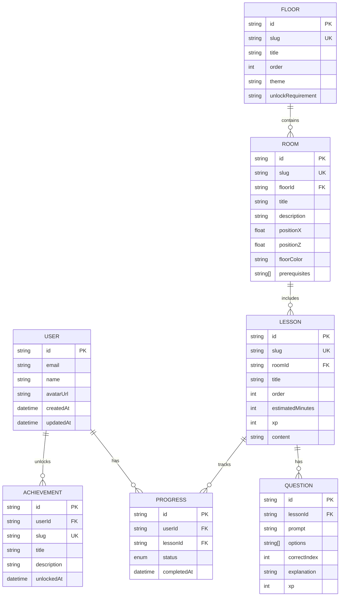

# Arquitetura e banco de dados

## Modelo de domínio

O núcleo do jogo é composto por usuários, progresso e conteúdo pedagógico organizados em andares, salas e aulas.

## Observações

- O conteúdo educacional é versionado em arquivos do repositório, mas o banco guarda o estado do usuário e o progresso individual.
- A estrutura de dados foi desenhada para permitir desbloqueio de conteúdo por prerequisites, gamificação por XP e conquistas por usuário.
- As salas e os andares podem ser reimportados de forma idempotente através do seed do Prisma.
